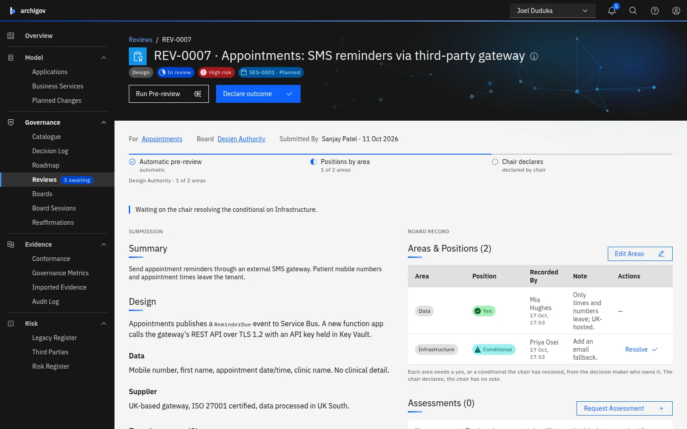

<picture>
  <source media="(prefers-color-scheme: dark)" srcset="docs/assets/banner-dark.png">
  
</picture>

# archigov

**Know what was approved. See what was built.**

Architecture decisions argued and decided on the record, then checked continuously against a model derived from your cloud estate and backlog.

Open-source architecture governance for Azure and Azure DevOps. It runs as one container with one SQLite file and no other services, and is usable in minutes with the demo estate or your own Azure subscription. The core is AGPL-3.0; packs, templates, connectors and importers are Apache-2.0.

[archigov.com](https://archigov.com) · [Live demo](https://demo.archigov.com) · [Documentation](https://archigov.com/docs) · [Quickstart](https://archigov.com/docs/getting-started/quickstart) · [How to contribute](#how-to-contribute)



## The problem

Architecture is decided at three levels, and at each one the same two things break. **Decision-making** is slow and happens off the record. **Auditing** means rebuilding afterwards, by hand, what was decided, who agreed, and whether the estate still matches.

| Level | What is decided there | What breaks today | What archigov does |
|---|---|---|---|
| **Enterprise** | Standards, principles, policies and the decisions that cross systems | Agreed in a forum, published as a document, then not applied. Showing a regulator which systems follow them, and who accepted which risk, is rebuilt from SharePoint and inboxes for every audit. | Each standard can carry [a rule that is checked against every system](https://archigov.com/docs/guides/writing-rules). [Adoption](https://archigov.com/docs/concepts/governance-catalogue#lifecycle), [positions](https://archigov.com/docs/concepts/boards-and-reviews#positions), [exceptions](https://archigov.com/docs/concepts/conformance#exceptions) and [accepted risks](https://archigov.com/docs/concepts/risk-register) sit on [one signed, hash-chained record](https://archigov.com/docs/concepts/evidence-and-audit), exportable to [OSCAL](https://archigov.com/docs/reference/exports#oscal) and [the DORA register](https://archigov.com/docs/reference/exports#dora-register-of-information). |
| **Solution** | A system's design and its trade-offs | Designs wait weeks for a monthly board and are rebuilt as slides. The rationale lives in decks, so six months later nobody can say what was decided, why, or who agreed. | Each review [goes to the board for its system](https://archigov.com/docs/tutorials/governance-levels#how-a-review-finds-its-board). [Area owners record their own positions](https://archigov.com/docs/concepts/boards-and-reviews#positions) when they are ready, and low-risk designs that follow adopted patterns [clear in a fast lane](https://archigov.com/docs/concepts/boards-and-reviews#fast-lane). Every decision keeps [its argument](https://archigov.com/docs/concepts/decisions#the-three-part-argument), [the options weighed](https://archigov.com/docs/concepts/decisions#what-a-decision-is--options-considered) and [the risks accepted](https://archigov.com/docs/concepts/decisions#accepted-risks). |
| **Delivery** | The changes teams plan and ship | Epics reach production without the decision they needed. Conditions and "for now" exceptions are never followed up. Drift from what was approved is found in the next incident. | [Planned changes from Azure DevOps that need a decision are flagged](https://archigov.com/docs/guides/azure-devops#a-feed-not-a-gate--needs-a-decision). [Conditions](https://archigov.com/docs/concepts/boards-and-reviews#resolving-a-conditional--accept-as-tracked-condition) and [exceptions](https://archigov.com/docs/concepts/conformance#exceptions) become obligations with an owner and a date. [The estate collected from Azure](https://archigov.com/docs/guides/connect-azure) is [checked continuously](https://archigov.com/docs/concepts/conformance#when-it-runs), and [drift goes back to the board that decided](https://archigov.com/docs/concepts/conformance#other-signals--decision-drift). |

The product never asserts compliance: it shows evidence and who stands behind it.

## Try it in one minute

No install needed for a first look: the [live demo](https://demo.archigov.com) is this release's UI on the same demo estate, read-only. To run it yourself:

```bash
docker run --rm -p 8080:8080 ghcr.io/00xe8/archigov
```

Open http://localhost:8080. On first start a demo estate loads: applications collected from a fictional Azure tenant, the core standards pack, two boards with seated members, reviews in several stages and open findings. The **View as** menu in the header switches between the demo's author, chair, decision makers and auditor, so you can walk a decision through the board as each of them. The image runs on amd64 and arm64; add `-v archigov-data:/data` to keep what you change.

## How it works

Every architecture decision is argued, linked and kept true:

| Stage | What happens |
|---|---|
| **[1 · Propose](https://archigov.com/docs/concepts/how-it-fits#the-lifecycle-of-a-decision--propose)** | **Argued, not asserted.** A decision states its [recommended option](https://archigov.com/docs/concepts/decisions#the-three-part-argument--recommended-option), the [justification](https://archigov.com/docs/concepts/decisions#the-three-part-argument--justification) (why it beats the alternatives) and the [consequences](https://archigov.com/docs/concepts/decisions#the-three-part-argument--consequences) of accepting it, including [the risks accepted](https://archigov.com/docs/concepts/decisions#accepted-risks). An optional [AI review](https://archigov.com/docs/concepts/ai#the-features--decision-review) tests the argument and names the evidence it is missing; missing evidence becomes [a tracked assessment](https://archigov.com/docs/concepts/assessments#assessments-on-a-decision) in one click. |
| **[2 · Link](https://archigov.com/docs/concepts/how-it-fits#the-lifecycle-of-a-decision--link)** | **Linked to what you already decided.** Decisions cite the [standards](https://archigov.com/docs/concepts/governance-catalogue#four-kinds-one-engine--standard), [principles](https://archigov.com/docs/concepts/governance-catalogue#four-kinds-one-engine--principle), [patterns](https://archigov.com/docs/concepts/governance-catalogue#four-kinds-one-engine--pattern), [policies](https://archigov.com/docs/concepts/governance-catalogue#four-kinds-one-engine--policy) and [earlier decisions](https://archigov.com/docs/concepts/decisions#links-between-decisions) they rest on, so contradictions surface while the decision is still a draft. |
| **[3 · Decide](https://archigov.com/docs/concepts/how-it-fits#the-lifecycle-of-a-decision--decide)** | **Coordinated, on the record.** [Typed reviews](https://archigov.com/docs/concepts/boards-and-reviews#reviews-are-typed) [route to the board that owns them](https://archigov.com/docs/concepts/boards-and-reviews#routing). Decision makers [record their own positions](https://archigov.com/docs/concepts/boards-and-reviews#positions), one per [area of responsibility](https://archigov.com/docs/concepts/boards-and-reviews#areas-of-responsibility). The chair has no vote: the chair [declares the outcome the positions allow](https://archigov.com/docs/concepts/boards-and-reviews#declaring-an-outcome). [Conditions](https://archigov.com/docs/concepts/boards-and-reviews#resolving-a-conditional--accept-as-tracked-condition) and [dependent decisions](https://archigov.com/docs/concepts/boards-and-reviews#dependent-decisions) are tracked to closure. |
| **[4 · Enforce](https://archigov.com/docs/concepts/how-it-fits#the-lifecycle-of-a-decision--enforce)** | **Checked against the real estate.** A [checkable constraint](https://archigov.com/docs/concepts/decisions#holding-the-estate-to-a-decision) runs continuously against [the model collected from Azure](https://archigov.com/docs/concepts/derived-model), never drawn by hand. [Drift raises a finding](https://archigov.com/docs/concepts/conformance#other-signals--decision-drift) and returns the decision to the board. |
| **[5 · Evolve](https://archigov.com/docs/concepts/how-it-fits#the-lifecycle-of-a-decision--evolve)** | **Kept true over its lifecycle.** The owning board's chair [reaffirms it on a cadence](https://archigov.com/docs/concepts/reaffirmations). When it is replaced, it is [superseded with its lineage intact](https://archigov.com/docs/concepts/decisions#status-and-lifecycle--superseded). Every step is [audited, hash-chained](https://archigov.com/docs/concepts/evidence-and-audit#the-audit-log) and in [the signed evidence pack](https://archigov.com/docs/concepts/evidence-and-audit#the-evidence-pack). |

## What's in it

Every item below links to the part of the [documentation](https://archigov.com/docs) that explains it.

**Decisions and the boards that make them**

- **[Architecture decision records](https://archigov.com/docs/concepts/decisions#what-a-decision-is)** (MADR style). Each has [context](https://archigov.com/docs/concepts/decisions#what-a-decision-is--context), [options considered](https://archigov.com/docs/concepts/decisions#what-a-decision-is--options-considered), [recommended option](https://archigov.com/docs/concepts/decisions#the-three-part-argument--recommended-option), [justification](https://archigov.com/docs/concepts/decisions#the-three-part-argument--justification) and [consequences](https://archigov.com/docs/concepts/decisions#the-three-part-argument--consequences). A decision can carry:
  - a [checkable constraint](https://archigov.com/docs/concepts/decisions#holding-the-estate-to-a-decision);
  - [dependent decisions](https://archigov.com/docs/concepts/boards-and-reviews#dependent-decisions);
  - [the risks it accepts](https://archigov.com/docs/concepts/decisions#accepted-risks), on the [risk register](https://archigov.com/docs/concepts/risk-register).
- **A [governance catalogue](https://archigov.com/docs/concepts/governance-catalogue)** of [standards](https://archigov.com/docs/concepts/governance-catalogue#four-kinds-one-engine--standard), [principles](https://archigov.com/docs/concepts/governance-catalogue#four-kinds-one-engine--principle), [patterns](https://archigov.com/docs/concepts/governance-catalogue#four-kinds-one-engine--pattern) and [policies](https://archigov.com/docs/concepts/governance-catalogue#four-kinds-one-engine--policy). Each item is a human statement, [control references](https://archigov.com/docs/concepts/governance-catalogue#control-references-never-control-text) (ISO 27001, DORA, DSPT, Cyber Essentials, AI Act, NIST…) and, where it can be, a [JSON rule](https://archigov.com/docs/guides/writing-rules). Items are versioned and [move from draft to in review, adopted and retired](https://archigov.com/docs/concepts/governance-catalogue#lifecycle); adoption happens only through a board. Five [packs](https://archigov.com/docs/concepts/governance-catalogue#packs) ship with it:
  - [core architecture rules](https://archigov.com/docs/concepts/governance-catalogue#packs--archigov-core);
  - [a governance starter](https://archigov.com/docs/concepts/governance-catalogue#packs--archigov-governance-starter);
  - [Azure Well-Architected-aligned standards](https://archigov.com/docs/concepts/governance-catalogue#packs--azure-waf-architecture);
  - [DORA ICT](https://archigov.com/docs/concepts/governance-catalogue#packs--dora-ict-architecture);
  - [AI Act Annex IV design evidence](https://archigov.com/docs/concepts/governance-catalogue#packs--ai-act-annex-iv-design).

  [CSV, JSON](https://archigov.com/docs/guides/importing#artefacts-from-csv-or-json) and [ArchiMate motivation elements](https://archigov.com/docs/guides/importing#archimate-open-exchange--motivation-elements) import any kind. Every kind of item stores [control references only, never control-body text](https://archigov.com/docs/concepts/governance-catalogue#control-references-never-control-text).
- **[Boards with an explicit workflow](https://archigov.com/docs/concepts/boards-and-reviews).** There are seven [review types](https://archigov.com/docs/concepts/boards-and-reviews#reviews-are-typed) ([design](https://archigov.com/docs/concepts/boards-and-reviews#reviews-are-typed--design), [decision](https://archigov.com/docs/concepts/boards-and-reviews#reviews-are-typed--decision), [standard](https://archigov.com/docs/concepts/boards-and-reviews#reviews-are-typed--standard-principle-pattern-policy), [principle](https://archigov.com/docs/concepts/boards-and-reviews#reviews-are-typed--standard-principle-pattern-policy), [pattern](https://archigov.com/docs/concepts/boards-and-reviews#reviews-are-typed--standard-principle-pattern-policy), [policy](https://archigov.com/docs/concepts/boards-and-reviews#reviews-are-typed--standard-principle-pattern-policy), [exception](https://archigov.com/docs/concepts/boards-and-reviews#reviews-are-typed--exception)), each with its own [automatic pre-review](https://archigov.com/docs/concepts/boards-and-reviews#pre-review) and [routed to the board that owns it](https://archigov.com/docs/concepts/boards-and-reviews#routing): by review type, kind and category, or [by the applications it is for, so a team can have its own board](https://archigov.com/docs/tutorials/team-boards). Two boards are seeded: a [Design Authority](https://archigov.com/docs/concepts/boards-and-reviews#boards--design-authority-da) and a [Policy & Compliance Board](https://archigov.com/docs/concepts/boards-and-reviews#boards--policy-compliance-board-pcb).
  - **[Seats](https://archigov.com/docs/concepts/boards-and-reviews#seats):** [chair](https://archigov.com/docs/concepts/boards-and-reviews#seats--chair), [decision maker](https://archigov.com/docs/concepts/boards-and-reviews#seats--decision-maker), [reviewer](https://archigov.com/docs/concepts/boards-and-reviews#seats--reviewer), [secretary](https://archigov.com/docs/concepts/boards-and-reviews#seats--secretary) and [observer](https://archigov.com/docs/concepts/boards-and-reviews#seats--observer).
  - **[Approval](https://archigov.com/docs/concepts/boards-and-reviews#approval-policies):** a policy either [counts approvals](https://archigov.com/docs/concepts/boards-and-reviews#approval-policies--count-mode) or [needs a position](https://archigov.com/docs/concepts/boards-and-reviews#approval-policies--areas-mode) from the owner of every **[area of responsibility](https://archigov.com/docs/concepts/boards-and-reviews#areas-of-responsibility)** a review touches.
  - **[Conditionals](https://archigov.com/docs/concepts/boards-and-reviews#positions--conditional):** a conditional position keeps the item open until the chair [resolves it with an explanation](https://archigov.com/docs/concepts/boards-and-reviews#resolving-a-conditional).
  - **[Assessments](https://archigov.com/docs/concepts/assessments):** a board can request [due diligence](https://archigov.com/docs/concepts/assessments#types-and-templates) (DPIA, security, supplier, clinical safety, AI impact…), [recorded by a named assessor](https://archigov.com/docs/concepts/assessments#two-flavours--who-records-the-result).
  - **[Fast lane](https://archigov.com/docs/concepts/boards-and-reviews#fast-lane):** low-risk designs that follow adopted patterns and pass [every deterministic check](https://archigov.com/docs/concepts/boards-and-reviews#risk-tier-and-checks) are declared without waiting for positions.
- **[Board sessions](https://archigov.com/docs/concepts/sessions).** The [agenda is derived, with a consent agenda](https://archigov.com/docs/concepts/sessions#planning-the-derived-agenda) for items already satisfied. [Attendance and per-session delegation](https://archigov.com/docs/concepts/sessions#attendance-and-delegation) give a [per-area quorum](https://archigov.com/docs/concepts/sessions#quorum-by-area). [Circulation](https://archigov.com/docs/concepts/sessions#circulation) finishes an item when an area's owner was absent. The **[minutes are derived from the records](https://archigov.com/docs/concepts/sessions#closing-and-minutes)**, hash-chained and in the evidence pack.
- **[Reaffirmations](https://archigov.com/docs/concepts/reaffirmations).** Every [adopted catalogue item and accepted decision](https://archigov.com/docs/concepts/reaffirmations#what-has-a-reaffirm-by-date) comes up [on a cadence](https://archigov.com/docs/concepts/reaffirmations#how-the-date-is-set). [The owning board's chair](https://archigov.com/docs/concepts/reaffirmations#who-reaffirms) states it [still holds or asks for a revision](https://archigov.com/docs/concepts/reaffirmations#reaffirming). A reaffirmation [approves nothing](https://archigov.com/docs/concepts/reaffirmations#what-it-deliberately-does-not-do--it-does-not-approve-anything-and-it-is-not-a-second-decision-log).

**The model decisions are held to**

- **[A derived as-is model](https://archigov.com/docs/concepts/derived-model)** from [Azure Resource Graph](https://archigov.com/docs/concepts/derived-model#sources--azure-resource-graph) or the [bundled demo estate](https://archigov.com/docs/concepts/derived-model#sources--demo-estate), with [CSV](https://archigov.com/docs/concepts/derived-model#sources--csv) and [ArchiMate (Open Exchange)](https://archigov.com/docs/concepts/derived-model#sources--archimate-open-exchange) as further sources. Resources are [grouped into applications](https://archigov.com/docs/concepts/derived-model#applications-are-inferred) by [tags](https://archigov.com/docs/concepts/derived-model#applications-are-inferred--tags) and [resource-group conventions](https://archigov.com/docs/concepts/derived-model#applications-are-inferred--resource-group-conventions), and [shared platforms become shared services](https://archigov.com/docs/concepts/derived-model#applications-are-inferred--shared-platform-resource-groups). Every element records how it was derived ([provenance](https://archigov.com/docs/concepts/derived-model#provenance-and-verification--provenance), confidence) and who stands behind it ([verification state](https://archigov.com/docs/concepts/derived-model#provenance-and-verification--verification)).
- **[Criticality and business services](https://archigov.com/docs/concepts/criticality).** Each application is [Critical](https://archigov.com/docs/concepts/criticality#what-a-classification-is--critical), [Important](https://archigov.com/docs/concepts/criticality#what-a-classification-is--important) or [Standard](https://archigov.com/docs/concepts/criticality#what-a-classification-is--standard), and names the [important business services](https://archigov.com/docs/concepts/criticality#what-a-classification-is--important-business-service-ibs) (PRA SS1/21, FCA SYSC 15A), [critical or important functions](https://archigov.com/docs/concepts/criticality#what-a-classification-is--critical-or-important-function-cif) (DORA) or [essential functions](https://archigov.com/docs/concepts/criticality#what-a-classification-is--essential-function) (NCSC CAF) that depend on it. This is [derived from tags](https://archigov.com/docs/concepts/criticality#derived-from-tags) and [confirmed or corrected by a person](https://archigov.com/docs/concepts/criticality#confirming-or-correcting-it) with a reason.
- **[Imported compliance evidence](https://archigov.com/docs/concepts/evidence-and-audit#imported-evidence).** [Defender for Cloud assessments](https://archigov.com/docs/concepts/evidence-and-audit#imported-evidence--microsoft-defender-for-cloud-assessments) and [Azure Policy states](https://archigov.com/docs/concepts/evidence-and-audit#imported-evidence--azure-policy-compliance-states) attach to resources as evidence and are never rebuilt. A resource with no evidence is [a finding, never a pass](https://archigov.com/docs/concepts/conformance#missing-evidence-is-a-finding).
- **[Planned changes](https://archigov.com/docs/guides/azure-devops).** The Azure DevOps backlog is [a feed, not a gate](https://archigov.com/docs/guides/azure-devops#a-feed-not-a-gate), and projects nobody's backlog knows yet can be [logged by hand](https://archigov.com/docs/guides/azure-devops#working-with-planned-changes--log-by-hand). The product flags [epics without a decision](https://archigov.com/docs/guides/azure-devops#a-feed-not-a-gate--needs-a-decision), and [requirements that changed after their design was approved](https://archigov.com/docs/guides/azure-devops#a-feed-not-a-gate--changed-after-approval).

**Conformance, registers and the roadmap**

- **[Continuous conformance](https://archigov.com/docs/concepts/conformance):** [standard violations](https://archigov.com/docs/concepts/conformance#findings), [drift from accepted decisions](https://archigov.com/docs/concepts/conformance#other-signals--decision-drift), [expired exceptions](https://archigov.com/docs/concepts/conformance#other-signals--expired-exceptions) and [overdue conditions](https://archigov.com/docs/concepts/risk-register#architecture-debt--overdue-condition), with [a diff per run](https://archigov.com/docs/concepts/conformance#when-it-runs) of what opened, resolved or reopened.
- **[A roadmap built from records](https://archigov.com/docs/concepts/roadmap):** [decisions](https://archigov.com/docs/concepts/roadmap#what-an-item-is--decision) and [how far the estate has realised them](https://archigov.com/docs/concepts/roadmap#decision-realisation), the [planned changes](https://archigov.com/docs/concepts/roadmap#what-an-item-is--planned-change) under them, [conditions](https://archigov.com/docs/concepts/roadmap#what-an-item-is--condition), [end-of-support deadlines](https://archigov.com/docs/concepts/roadmap#what-an-item-is--end-of-support) and [expiring exceptions](https://archigov.com/docs/concepts/roadmap#what-an-item-is--exception), in [Now, Next, Later and Done](https://archigov.com/docs/concepts/roadmap#lanes-by-date).
- **[A legacy register](https://archigov.com/docs/concepts/legacy-register):** [OS images, runtimes, database engines and Kubernetes versions](https://archigov.com/docs/concepts/legacy-register#what-is-tracked) against [their vendors' support dates](https://archigov.com/docs/concepts/legacy-register#the-lifecycle-data), and the [yearly legacy assessment](https://archigov.com/docs/concepts/legacy-register#the-yearly-legacy-assessment) DORA Art. 8(7) asks for.
- **[Third parties](https://archigov.com/docs/concepts/third-parties):** the [providers](https://archigov.com/docs/concepts/third-parties#providers-are-derived) the estate relies on, [concentration](https://archigov.com/docs/concepts/third-parties#concentration) of critical applications (marking the UK's [designated critical third parties](https://archigov.com/docs/concepts/third-parties#the-designations)), and an [exit plan](https://archigov.com/docs/concepts/third-parties#exit-plans) for each critical reliance.
- **[A risk register](https://archigov.com/docs/concepts/risk-register) and the [architecture debt](https://archigov.com/docs/concepts/risk-register#architecture-debt) behind it.** Risks come from [decisions](https://archigov.com/docs/concepts/risk-register#where-risks-come-from--decision), [active exceptions](https://archigov.com/docs/concepts/risk-register#where-risks-come-from--exception) and [authors](https://archigov.com/docs/concepts/risk-register#where-risks-come-from--logged); debt ([aged findings](https://archigov.com/docs/concepts/risk-register#architecture-debt--aged-finding), [drift](https://archigov.com/docs/concepts/risk-register#architecture-debt--drift-from-a-decision), [overdue conditions](https://archigov.com/docs/concepts/risk-register#architecture-debt--overdue-condition), [end-of-life components](https://archigov.com/docs/concepts/risk-register#architecture-debt--end-of-life-component)…) is derived, never logged.

**Evidence, not assurance**

- **[A signed evidence pack](https://archigov.com/docs/concepts/evidence-and-audit#the-evidence-pack)** ([Ed25519 signature](https://archigov.com/docs/reference/exports#evidence-pack--signature), [SHA-256](https://archigov.com/docs/reference/exports#evidence-pack--hash), and a [hash chain over the audit log](https://archigov.com/docs/concepts/evidence-and-audit#the-audit-log) that anyone can [re-verify](https://archigov.com/docs/reference/exports#verifying-a-pack)).
- **[Exports](https://archigov.com/docs/reference/exports):** [OSCAL 1.1.2 assessment results](https://archigov.com/docs/reference/exports#oscal), a clearly labelled [DORA register-of-information CSV](https://archigov.com/docs/reference/exports#dora-register-of-information), and [ArchiMate Open Exchange deployment views](https://archigov.com/docs/reference/exports#archimate-open-exchange) that open in Archi.
- **[Governance metrics](https://archigov.com/docs/concepts/governance-metrics)** ([review lead times](https://archigov.com/docs/concepts/governance-metrics#reviews--lead-time) and [decision lead times](https://archigov.com/docs/concepts/governance-metrics#decisions-conditions-and-exceptions--decisions-accepted), [recycling](https://archigov.com/docs/concepts/governance-metrics#reviews--recycled), [exception ageing](https://archigov.com/docs/concepts/governance-metrics#decisions-conditions-and-exceptions--exceptions), [the conformance trend](https://archigov.com/docs/concepts/governance-metrics#conformance--open-findings-trend), [coverage](https://archigov.com/docs/concepts/governance-metrics#coverage)) and **[signed board packs](https://archigov.com/docs/concepts/governance-metrics#board-packs)** prepared from them.
- **[Human verification state](https://archigov.com/docs/concepts/how-it-fits#verification-state-is-first-class)** on everything derived, inferred or AI-generated. It is dated and named, and [drops back automatically](https://archigov.com/docs/concepts/derived-model#provenance-and-verification) when the underlying evidence changes.

**People and access**

- **Sign-in:** [Microsoft Entra ID (OpenID Connect)](https://archigov.com/docs/guides/sign-in-entra), or a [local mode](https://archigov.com/docs/reference/configuration#sign-in--auth-mode) for a trusted network and first runs.
- **[Two levels of access](https://archigov.com/docs/reference/roles-and-capabilities#two-levels).** A [system role](https://archigov.com/docs/reference/roles-and-capabilities#two-levels--system-role) (**[author](https://archigov.com/docs/reference/roles-and-capabilities#capabilities-by-system-role-and-flag)**, **[auditor](https://archigov.com/docs/reference/roles-and-capabilities#capabilities-by-system-role-and-flag)** or **[service account](https://archigov.com/docs/reference/roles-and-capabilities#capabilities-by-system-role-and-flag)**) sets what a person can author or read. A separate **[platform admin](https://archigov.com/docs/reference/roles-and-capabilities#two-levels--platform-admin)** flag covers operations only and grants nothing in a review. Approving and deciding come from **[board seats](https://archigov.com/docs/reference/roles-and-capabilities#two-levels--board-seats)** alone.
- **[A work queue, not just a dashboard](https://archigov.com/docs/concepts/boards-and-reviews#the-work-queue).** The Overview and the header's notifications show what waits on *you*: [positions](https://archigov.com/docs/concepts/boards-and-reviews#positions), [declarations](https://archigov.com/docs/concepts/boards-and-reviews#declaring-an-outcome), [assessments](https://archigov.com/docs/concepts/assessments#where-assessments-appear), [conditions](https://archigov.com/docs/concepts/boards-and-reviews#resolving-a-conditional--accept-as-tracked-condition) and [reaffirmations due](https://archigov.com/docs/concepts/reaffirmations#in-the-work-queue). It is derived from the same rules the API enforces.

**AI proposes, humans decide**

There are [eleven AI features](https://archigov.com/docs/concepts/ai#the-features), and the platform admin [switches each one on separately](https://archigov.com/docs/guides/ai-providers#2-enable-features) with its own provider and model:

- [decision review](https://archigov.com/docs/concepts/ai#the-features--decision-review);
- [pre-review with citations that must resolve](https://archigov.com/docs/concepts/ai#the-features--pre-review);
- [decision drafting](https://archigov.com/docs/concepts/ai#the-features--decision-drafting);
- [rule drafting](https://archigov.com/docs/concepts/ai#the-features--rule-drafting), validated and dry-run before anyone saves;
- [control-reference suggestions](https://archigov.com/docs/concepts/ai#the-features--control-references);
- [assessment drafting](https://archigov.com/docs/concepts/ai#the-features--assessment-drafting);
- [session-notes drafting](https://archigov.com/docs/concepts/ai#the-features--session-notes-drafting);
- [evidence mapping](https://archigov.com/docs/concepts/ai#the-features--evidence-mapping);
- [classification suggestions](https://archigov.com/docs/concepts/ai#the-features--classification-suggestion);
- [risk extraction](https://archigov.com/docs/concepts/ai#the-features--risk-extraction);
- [the board-pack narrative](https://archigov.com/docs/concepts/ai#the-features--board-pack-narrative).

Providers are [OpenAI](https://archigov.com/docs/guides/ai-providers#1-add-a-provider--openai), [Claude (Anthropic)](https://archigov.com/docs/guides/ai-providers#1-add-a-provider--claude-anthropic), [Mistral](https://archigov.com/docs/guides/ai-providers#1-add-a-provider--mistral), [Ollama](https://archigov.com/docs/guides/ai-providers#1-add-a-provider--ollama), or any OpenAI-compatible endpoint, with your own keys, [encrypted at rest](https://archigov.com/docs/guides/ai-providers#keys-stored-in-settings). Every feature has a [deterministic fallback](https://archigov.com/docs/concepts/ai#when-a-feature-is-off), and every output is marked AI-generated. Nothing an AI writes approves, blocks or becomes the record without [a named person's audited act](https://archigov.com/docs/concepts/ai#the-boundary).

UI: IBM Carbon (`@carbon/react` 1.118.0, `@carbon/charts-react` 1.27.21, IBM Plex bundled locally).

## Run it

### With Docker

Every release is published to the GitHub Container Registry for amd64 and arm64, as `ghcr.io/00xe8/archigov:<version>` and `:latest`:

```bash
docker run -d --name archigov -p 8080:8080 -v archigov-data:/data ghcr.io/00xe8/archigov
# open http://localhost:8080
```

From a clone, `docker compose up --build` builds the same image from source.

Data lives in the `archigov-data` volume (`/data/app.db`, `/data/blobs`, `/data/backups`, `/data/keys`, `/data/evidence-packs`). Nightly backups keep the last 14 copies. To upgrade, pull the new tag and recreate the container on the same volume, or from a clone `git pull && docker compose up -d --build`; migrations run on start. `docker-compose.prod.yml` is the self-host production example; [infra/README.md](infra/README.md) has the deployment notes and the full environment matrix, and `infra/litestream/` an example replication config.

### Without Docker (Node 22)

```bash
cd web && npm install && npm run build && cd ..
cd server && npm install && npm run build && npm start
# open http://localhost:8080
```

For development: `cd server && npm run dev` (API on 8080) and `cd web && npm run dev` (UI on 5173 with a proxy to the API).

## Configuration (all optional)

| Variable | Purpose |
|---|---|
| `DATA_DIR`, `PORT`, `SEED_DEMO` | Data directory (`/data` in the container); port (8080); `SEED_DEMO=true` (default) loads the demo estate into an empty database on first boot. |
| `APP_BASE_URL` | Public URL of the instance, used for sign-in redirects and secure cookies (e.g. `https://archigov.example.org`). |
| `AUTH_MODE` | `local` (default): a trusted-network mode where the acting user is chosen in the UI's **View as** menu (or sent as `x-user`) and an unknown user is a platform admin only (no role, no seats). `entra`: Microsoft Entra ID sign-in is required for everything except `/api/health` and inbound webhooks. |
| `ENTRA_TENANT_ID`, `ENTRA_CLIENT_ID`, `ENTRA_CLIENT_SECRET` | Entra app registration (authorization code + PKCE; the secret is optional for a public client). Redirect URI: `<APP_BASE_URL>/api/auth/callback`. App-role values: a system role (`author`, `auditor`, `service`), `platform_admin` for the admin flag, and board seats as `DA:chair`, `PCB:decision_maker`, `board/DA/reviewer`; the older names (`admin`, `architect`, `engineer`, `submitter`, `chair`, `reviewer`, `board_member`) are accepted as aliases (`ENTRA_ROLE_MAP` can remap). Users without a role get `ENTRA_DEFAULT_ROLE` (default `author`). Board membership can also be managed in Settings → Access and on each board. |
| `SESSION_SECRET` | Session-cookie signing secret; generated into `DATA_DIR/keys/session.secret` when unset. |
| `AZURE_TENANT_ID`, `AZURE_CLIENT_ID`, `AZURE_CLIENT_SECRET`, `AZURE_SUBSCRIPTIONS` | Read-only collection via Resource Graph (Reader on the subscriptions), Defender for Cloud assessments and Azure Policy compliance states (Security Reader / Reader). Only metadata is read. Managed identity works without the secret. |
| `ADO_ORG`, `ADO_PROJECT`, `ADO_PAT`, `ADO_WIQL`, `ADO_HOOK_SECRET` | Azure DevOps backlog feed: WIQL backfill (default query: epics and features not removed, changed in the last year) and a service-hook receiver at `POST /api/hooks/ado` authenticated by the `x-archigov-hook-secret` header or basic-auth password. Without a PAT, an Entra token is used (scope `https://app.vssps.visualstudio.com/.default`). |
| `ARCHIGOV_FIXTURES=1` | Fixture mode: every Azure and DevOps call is answered from recorded-shape fixtures so the real integration code runs offline (used by the smoke scripts and useful for demos). |
| `AI_OPENAI_API_KEY`, `AI_ANTHROPIC_API_KEY`, `AI_MISTRAL_API_KEY`, `AI_OLLAMA_API_KEY` (each also as `…_FILE`) | AI provider keys from the environment; they beat a key saved in Settings · AI and never touch the database. Providers, models and each feature are switched on in Settings · AI; with nothing configured, every feature uses its deterministic fallback. |
| `ARCHIGOV_SECRET_KEY` | Master key for secrets saved in Settings (AI provider keys), encrypted with AES-256-GCM so backups and replicas carry only ciphertext. Unset: a generated `DATA_DIR/keys/secret.key` that is never replicated. |
| `LLM_BASE_URL`, `LLM_API_KEY`, `LLM_MODEL` | Legacy: one OpenAI-compatible endpoint for any AI feature not configured in Settings · AI. |
| `LITESTREAM_URL` or `LITESTREAM_CONFIG` (+ `LITESTREAM_ACCESS_KEY_ID`, `LITESTREAM_SECRET_ACCESS_KEY`, `AWS_ENDPOINT`, `AWS_REGION`) | Continuous replication of the SQLite file to object storage (S3, R2, any S3-compatible store) or another disk, and restore on start when the volume is empty. Use it in production when losing the volume or host must not lose data, and on platforms with ephemeral disks. What, when and how: [infra/README.md · Replication](infra/README.md#replication-with-litestream). |

Credentials from the environment never go into the database. AI provider keys saved in Settings are stored only as ciphertext, are never returned by the API, and are never audited or exported. The evidence-signing key pair lives in `DATA_DIR/keys/` (`evidence-signing.key` 0600, `.pub` 0644).

## Rule format

```json
{
  "scope": "resource",
  "match": { "type": "Microsoft.Storage/storageAccounts" },
  "assert": { "op": "evidence", "source": "defender",
              "control": "storage-public-access", "state": "pass" }
}
```

`scope` is `resource` or `application`. `match` takes `type`, `typeIn`, `typePrefix` and `where` (a list of assertions). Assertion ops: `eq neq in notIn exists missing gte lte matches` on a `path` (normalised props such as `props.publicAccess`, `props.minTlsVersion`, `props.osSku`, `props.location`, `tags.owner`, and the owning application's classification as `app.criticality`, `app.regulated`, `app.services`, `app.service_kinds` — usable in `where` at either scope); `evidence` (imported Defender / Azure Policy / manual evidence for a `control` must exist in `state`, default `pass`; missing evidence is a finding); `lifecycle` (a resource's worst component must not be in `states`, default `["end_of_life"]`; `lifecycle.*` is also readable in `where`); `decisionConstraint` (the resource must match the application's accepted decision on a `topic`); and application-level `hasDecision`, `hasOwnerTag`, `maxResourcesOfType`, `assessmentCurrent` (`kind: "legacy"`: the yearly legacy assessment is in date and covers every legacy component; `kind: "exit_plan"`: every provider a critical or important application relies on has an exit plan in date). An unknown op is a rule error, never a pass.

## Verify it

```bash
cd server && npm test                  # unit tests (node:test via tsx)
B=http://localhost:8080
scripts/smoke.sh $B                    # the end-to-end governance flow
scripts/smoke-auth.sh $B               # roles, segregation of duties, audit chain, signed pack
scripts/smoke-boards.sh $B             # boards, routing, approval policies, fast lane
scripts/smoke-sessions.sh $B           # areas, positions, sessions, delegation, minutes
scripts/smoke-work.sh $B               # the role-aware work queue and the pipeline
scripts/smoke-registers.sh $B          # classification, registers, metrics, reaffirmations, risks
scripts/smoke-catalogue.sh $B          # kinds, lifecycle, imports (once per fresh instance)
scripts/smoke-integrations.sh $B       # instance with ARCHIGOV_FIXTURES=1 and ADO_HOOK_SECRET
scripts/smoke-empty.sh $B              # instance with SEED_DEMO=false: the first run
```

Run the first seven in that order on one fresh demo instance, and the last two each on its own fresh instance; they mutate the data. Reset the demo with `docker compose down -v && docker compose up -d`.

## Layout

```
server/src/routes/       the /api modules, one per domain
server/src/auth/         sessions, Entra OpenID Connect, roles, platform flag, board seats → capabilities
server/src/boards/       routing, approval policies, positions, declarations, assessments, sessions,
                         fast lane, the work queue
server/src/artefacts.ts  the governance catalogue: kinds, lifecycle, pre-review checks, dry runs, imports
server/src/rules.ts      the rule DSL, its validator and the evaluation engine
server/src/model.ts      the derived model; beside it classification, lifecycle (legacy register),
                         suppliers, risks, roadmap, metrics and signoffs (reaffirmations)
server/src/packs/        policy packs                          (Apache-2.0)
server/src/templates/    assessment templates                  (Apache-2.0)
server/src/azure/        Resource Graph, Defender, Azure Policy (Apache-2.0)
server/src/ado/          Azure DevOps                          (Apache-2.0)
server/src/importers/    CSV and ArchiMate importers           (Apache-2.0)
server/src/exporters/    ArchiMate Open Exchange views
server/src/migrations/   one file per schema version, auto-loaded
web/src/                 React 18 + Carbon UI, built to web/dist and served by the server
docs/features/           one page per feature: what it does, who may do what, API, audit, limits
scripts/                 smoke scripts
infra/                   deployment notes and a Litestream example
```

## How to contribute

Contributions are welcome. The ones that help most carry domain knowledge from other architects, and they need the least paperwork:

| Contribute | Where | You need |
|---|---|---|
| A **policy pack**, e.g. ISO 27001 design controls, NHS DSPT, NCSC CAF | `server/src/packs/`: one file, plus one line in `index.ts`; `packs.test.ts` checks it automatically | A DCO sign-off |
| An **assessment template** | `server/src/templates/` | A DCO sign-off |
| A **connector** or an **importer**, e.g. AWS, GCP, Jira, GitHub Issues, LeanIX, Ardoq | Follow `server/src/azure/`, `server/src/ado/` and `server/src/importers/`. Open an issue first, so a new folder joins the Apache-2.0 list before your pull request | A DCO sign-off |
| A fix or a feature in the **core** | Anywhere else | A DCO sign-off, and the [CLA](docs/CLA.md) once |

Getting started:

```bash
git clone https://github.com/00xE8/archigov && cd archigov
cd server && npm install && npm run dev    # terminal 1: the API on :8080, demo estate loaded
cd web && npm install && npm run dev       # terminal 2, from the repo root: the UI on :5173
```

Open http://localhost:5173; the **View as** menu in the header switches between the demo users (author, chair, decision maker, auditor…). Before you push, run `npm test` and `npm run typecheck` in `server/`, and `npm run typecheck` in `web/` if you touched it. Commit with `git commit -s`.

- **Sign off every commit.** `-s` adds `Signed-off-by:`, certifying the [Developer Certificate of Origin](DCO); the **DCO** check verifies it.
- **The CLA is only for the core.** If your commits change core files, the **archigov CLA** check asks you, once, to agree by commenting one sentence on the pull request. It is a licence grant on the Apache model, and you keep your copyright.
- **Process:** one pull request per change, with conventional commits (`feat(packs): …`, `fix(azure): …`). For a pack, template, connector or importer, the maintainer adds the CHANGELOG line and docs, and runs the full quality gate before merging.
- **Two product rules are not negotiable:**
  - nothing asserts compliance: the product shows evidence and who stands behind it;
  - AI output never changes state: it drafts, and a named person's audited act promotes it.

[CONTRIBUTING.md](CONTRIBUTING.md) has the details: what each folder expects, fixing a missed sign-off, and how the CLA is recorded.

### With an AI coding agent

Agent-assisted contributions are welcome. [AGENTS.md](AGENTS.md) is the brief your agent should read first: the product rules, the licence boundary, the commands and a definition of done. [docs/agents/](docs/agents/) has ready-made prompts for a policy pack, an assessment template, a connector or importer, and a core change.

A starting prompt:

```text
Read AGENTS.md and CONTRIBUTING.md in this repository and follow them.
Then follow docs/agents/new-policy-pack.md to add a pack for <framework>.
Stay inside the folder it names and run the tests. Never add a sign-off: I will
review the diff and sign off myself.
```

You remain the contributor:
- review the diff;
- sign off yourself;
- agree to the CLA yourself if a core change needs it;
- mark agent-written commits with an `Assisted-by:` trailer.

## Licensing

Two licences, by folder. The core is copyleft. The content architects most want to share is permissive, and so is the code that connects archigov to other systems:

| Part | Licence | To contribute |
|---|---|---|
| **The core:** the derived model, the rules engine, boards and reviews, evidence and audit, exporters, the web UI. Everything not listed below | **AGPL-3.0-only** ([LICENSE](LICENSE)) | A [DCO](DCO) sign-off on each commit, and the [CLA](docs/CLA.md) once |
| **Policy packs** `server/src/packs/` · **assessment templates** `server/src/templates/` · **connectors** `server/src/azure/`, `server/src/ado/` · **importers** `server/src/importers/` | **Apache-2.0** ([LICENSE-APACHE](LICENSE-APACHE)) | A DCO sign-off only |

The folder list is kept in [.github/licensing.json](.github/licensing.json), and every file in those folders carries an `SPDX-License-Identifier: Apache-2.0` header. The policy SDK (the rule DSL and its validator as a package) will join the Apache-2.0 side when it is split out. [CONTRIBUTING.md](CONTRIBUTING.md) explains the DCO and the CLA.

What the AGPL means in practice:

- **Run it yourself, even modified, for your own organisation**: no obligations. The AGPL's network clause (section 13) applies only when you offer the software as a service to third parties; your own employees are not third parties.
- **Host a modified version for others**: you must offer them your modified source. That is the point: nobody can take this product, bolt on closed features and sell access to it without contributing those features back.
- **Host an unmodified copy for clients**: allowed. Consultancies running archigov for customers are distribution, not a threat.

**Commitments, stated publicly:**

- **This project will never move to a licence more restrictive than AGPL-3.0.** No BSL, no SSPL, no rug-pull. Decided on day one.
- **Nothing is held back from the open-source release.** There is no closed edition, and any other licence the project grants covers the same code.
- **The CLA is a licence grant, not a copyright assignment.** Contributors keep their copyright. It is only needed for the AGPL core, where it keeps the option to license the core under other terms.

Copyright © 2026 Skygge Ltd and contributors. Skygge Ltd maintains the project and receives the CLA's grant. The app shows these notices, and offers the source of the running version, under **About archigov** in its help panel and on the sign-in page. Whoever hosts a modified build for others sets `SOURCE_URL` to their own source.

**Trademarks.** The name archigov and the plumb mark are trademarks of Skygge Ltd, and neither licence grants a right to use them. Refer to the project freely, and share unmodified releases under its name; a modified version needs its own name and logo. See [TRADEMARKS.md](TRADEMARKS.md).

## Not in this release

These are the most useful places to contribute:

- AWS and GCP collectors;
- Jira and GitHub Issues as backlog sources;
- LeanIX and Ardoq importers;
- AI import of Visio, PPTX and Word;
- ISO 27001 design-control and DSPT/CAF packs.

In-app multi-tenancy and rate limiting on `/hooks` and `/auth` are also not in this release; the managed service maps tenants to containers.

**Verification status:**
- Resource Graph, Defender for Cloud and Azure Policy collection has been verified against a live tenant. That tenant was small, so paging and quota handling at volume are not yet proven.
- Entra sign-in and Azure DevOps are verified on recorded fixtures only.
- The DORA CSV column codes follow the ITS annex as reproduced in the EBA draft. Confirm them against the Official Journal text before external use.
